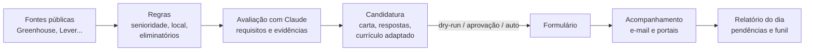

<h1 align="center">jobbot</h1>

<p align="center">
  <strong>Agente pessoal de candidaturas a vagas de estágio e júnior, rodando na sua máquina.</strong><br>
  Busca, avalia, prepara e acompanha candidaturas todo dia, sem inventar nada sobre você.
</p>

<p align="center">
  
  
  
  
  
  
</p>

---

Todo dia ele:

1. busca vagas em fontes públicas;
2. filtra por regras e pontua de 0 a 100 com o Claude (`claude -p`);
3. prepara a candidatura com o seu currículo e uma carta adaptada à vaga, e envia ou não conforme o modo;
4. acompanha os processos pelo seu e-mail e pelos portais;
5. cria pendências para o que só você pode fazer (testes, entrevistas, vídeos), com material de treino;
6. gera um relatório em `reports/AAAA-MM-DD.md` e, se você quiser, avisa pelo Telegram ou por e-mail.



## Destaques

- **Nada inventado, conferido no código.** Cada afirmação de carta, resposta, resumo do currículo ou história de
  entrevista precisa de um trecho literal dos seus documentos. Termo técnico, empresa ou número que não esteja lá
  derruba o texto.
- **Avaliação de cada vaga** com tabela de requisitos, citação da vaga, sua evidência, lacunas e como lidar com elas.
- **Currículo adaptado por vaga** em PDF compatível com ATS, no idioma da vaga, que só reordena o que já existe.
- **Seguro por padrão.** Começa em `dry-run`, para em CAPTCHA, senha, salário e dados sensíveis, nunca candidata
  duas vezes e respeita `robots.txt` e termos de uso.
- **Acompanha o processo.** Lê o e-mail (só leitura), detecta etapas, cria pendências com prazo, gera material de
  treino e rascunhos de follow-up.
- **Tudo local e auditável.** SQLite com o registro de cada ação; seus dados nunca entram no git.

## O que ele nunca faz

- Inventar fatos. Cartas e respostas usam só o que está em `config/profile.yaml` e `documents/`. Cada afirmação
  passa por uma checagem de evidência antes de ser usada.
- Resolver testes ou avaliações por você. Ele detecta, registra prazo e link, avisa e gera exercícios **de treino**.
- Enviar sem você decidir. O modo padrão é `dry-run`; trocar de modo é decisão sua.
- Ler, guardar ou digitar senhas. Login em portais é feito por você, no navegador. Campo de senha faz o
  preenchimento parar.
- Contornar CAPTCHA ou bloqueio anti-bot. Ele para e chama você.
- Responder pretensão salarial, dados sensíveis ou perguntas ambíguas sem você. Ele para e sinaliza.
- Candidatar duas vezes à mesma vaga. Envio com resultado incerto nunca é repetido sozinho.
- Coletar de sites cujos termos de uso proíbem. Essas fontes ficam desligadas.

## Instalação

Precisa de Python 3.11+, [uv](https://docs.astral.sh/uv/) e do [Claude Code](https://claude.com/claude-code)
instalado e logado (o comando `claude` precisa funcionar no terminal).

```bash
cd jobbot
uv sync
uv run playwright install chromium
```

## Configuração

1. **Perfil**: copie `config/profile.example.yaml` para `config/profile.yaml` e troque pelos seus dados.
   Tudo ali é tratado como verdade. Use `facts` para fatos verdadeiros que não estão no currículo.
   Enquanto o e-mail terminar em `@exemplo.com`, nenhum envio real acontece.
2. **Documentos**: coloque o currículo (PDF ou DOCX) em `documents/` e aponte `documents.resume` para ele.
   Se tiver um currículo em inglês, aponte `documents.resume_en`: as vagas escritas em inglês usam ele na
   pontuação, na carta e no anexo. Histórico, portfólio etc. vão em `documents.extras`. PDFs gerados em LaTeX
   funcionam: os acentos soltos que a extração de texto produz são corrigidos.
3. **Preferências**: `config/settings.yaml` tem o modo, o score mínimo, o limite diário, as fontes ligadas,
   o acompanhamento por e-mail, as notificações e a resposta automática.
4. **Segredos (opcional)**: copie `.env.example` para `.env`. Só é preciso para ler e-mail (IMAP), enviar
   e-mail (SMTP) ou usar o Telegram. Use uma *senha de app* do seu provedor, nunca a senha principal.

Confira tudo com:

```bash
uv run jobbot status
```

## Primeiro uso

```bash
uv run jobbot search     # busca vagas
uv run jobbot score      # filtra e pontua
uv run jobbot apply      # em dry-run: preenche sem enviar
uv run jobbot report     # relatório do dia
```

Em dry-run, cada candidatura fica em `data/applications/<id>/`:

- `pacote.md`: link, score, avaliação da vaga, carta e respostas prontas;
- `carta.txt`: carta usada no formulário;
- `curriculo-adaptado.pdf`: seu currículo reordenado para a vaga;
- `formulario.png`: o formulário preenchido, sem envio e sem anexos.

Quando o resultado parecer bom, passe para `approval`: `uv run jobbot apply --mode approval` mostra cada
candidatura e pergunta antes de enviar. Rodando agendado, sem terminal, elas ficam esperando
`jobbot approve <id>`. Use `auto` só quando confiar no que está sendo enviado.

| Modo | O que acontece |
|---|---|
| `dry-run` (padrão) | Prepara e preenche, nunca envia. Você pode enviar depois com `jobbot approve <id>`. |
| `approval` | Pede sua confirmação para cada envio. |
| `auto` | Envia sozinho as vagas com score acima de `min_score`, até `daily_application_limit` por dia. |

## Avaliação de cada vaga

Antes do Claude, regras descartam o que não serve: senioridade, local, anos de experiência, palavras negativas e
os seus `dealbreakers` (critérios eliminatórios, como "contrato PJ"). O que passa é avaliado e ganha um arquivo
`reports/vagas/<id>.md`, com o link no relatório do dia e no pacote da candidatura:

- **Requisitos**: até 12, cada um com o peso na vaga (crítico, alto, relevante, desejável), se você atende e a
  evidência nos seus documentos. O peso vem do texto da vaga: se o Claude não citar o trecho literal, o peso é
  tratado como estimativa e não pode ser crítico. Evidência que não está nos seus documentos é descartada.
- **Lacunas e como lidar**: para cada requisito importante que falta, uma forma honesta de lidar.
- **Alertas** e **legitimidade**: sinais de vaga fantasma (publicação antiga, descrição genérica...), como sinais
  para você decidir, nunca como acusação.

Antes de candidatar, o jobbot confere se a vaga ainda está aberta. Vaga encerrada não gasta Claude e não fica parada.

A ideia da tabela de requisitos, das lacunas e dos sinais de legitimidade veio do
[career-ops](https://github.com/career-ops-hq/career-ops) (licença MIT).

## Currículo adaptado à vaga

Cada candidatura ganha `curriculo-adaptado.pdf` na pasta do pacote: o seu currículo, no idioma da vaga, com as
linhas mais relevantes primeiro, em um layout simples que sistemas de recrutamento (ATS) leem bem.

- Na primeira vez, o Claude divide o currículo em seções e linhas. O código confere que cada linha existe no
  original; o resultado fica em `data/cv/` até o currículo mudar.
- Para cada vaga, o Claude só escolhe a ordem das linhas. Ele pode reescrever o resumo do topo, mas cada fato
  precisa de evidência literal, e qualquer tecnologia, empresa ou número que não esteja no currículo derruba a
  reescrita: fica o resumo original.
- O pacote mostra quantos requisitos importantes da vaga têm evidência no seu currículo, e quais não têm.

Por padrão o anexo continua sendo o seu PDF original. Para anexar o adaptado, use `cv.upload_tailored: true` no
`settings.yaml`; para não gerar, `cv.tailor: false`. Ideia do [career-ops](https://github.com/career-ops-hq/career-ops).

## Fontes

| Fonte | Padrão | Como |
|---|---|---|
| Greenhouse e Lever | ligadas | APIs públicas das páginas de carreira. Edite `boards` e `companies` em `settings.yaml`. |
| Programathor | ligada | Páginas públicas. A candidatura exige login, então fica para você enviar. |
| Gupy | desligada | Os termos de uso proíbem agregar ou copiar partes da plataforma. |
| Vagas.com | desligada | Os termos de uso proíbem reproduzir o conteúdo. |
| LinkedIn e Indeed | sem automação | Pelos alertas no seu e-mail, ou por `jobbot add`. |

Gupy e Vagas.com estão implementadas. Ligar ou não é decisão sua, depois de ler os termos.

Ficaram de fora de propósito: a API do SmartRecruiters proíbe robôs no `robots.txt` (só libera o do LinkedIn), e a
do Ashby (Nubank) responde ao `robots.txt` com acesso negado, que o jobbot trata como proibido. Para seguir uma
empresa nova no Greenhouse ou no Lever, acrescente o nome que aparece na URL de vagas dela
(`job-boards.greenhouse.io/<nome>` ou `jobs.lever.co/<nome>`) em `boards` ou `companies`.

**LinkedIn e Indeed sem automação**, de dois jeitos:

- **Alertas por e-mail**: crie alertas de vaga no LinkedIn e no Indeed e ligue `sources.email_alerts` (precisa de
  IMAP no `.env`). O jobbot lê só os e-mails desses remetentes e registra as vagas como "para você enviar".
- **`jobbot add <url>`**: abra a vaga, copie o texto da página (Ctrl+A, Ctrl+C) e rode o comando com o link.
  O jobbot pontua e prepara carta e respostas.

As vagas que só você pode enviar aparecem no relatório com link e pacote. Depois de enviar, rode
`jobbot done <id>`. Se o acompanhamento por e-mail estiver ligado, a confirmação da empresa já registra o envio.

## Quando a candidatura para

O relatório lista cada candidatura parada e o motivo:

- **CAPTCHA ou verificação anti-bot**: envie à mão pelo link e rode `jobbot done <id>`.
- **Login**: rode `jobbot login <url>`, entre na janela do navegador e feche. A sessão fica em
  `data/browser_profile/`. Depois rode `jobbot apply --retry-blocked`.
- **Pretensão salarial**: sempre para. Responda à mão.
- **Pergunta sensível obrigatória** (CPF, PcD, raça, orientação, consentimentos...): para. Se a pergunta for
  opcional, fica em branco. Para respostas que você decidiu dar sempre, use `saved_answers` no perfil:

  ```yaml
  saved_answers:
    - match: "pessoa com deficiência"   # trecho da pergunta
      answer: "Não"
  ```

- **Pergunta que seus documentos não respondem**: para. O pacote traz o que já dá para responder.

`jobbot reject <id>` descarta uma candidatura.

## Acompanhamento

`jobbot track` faz duas coisas:

- **Portais**: visita a página das vagas enviadas e registra as encerradas.
- **E-mail** (com `tracking.email: true` e IMAP no `.env`): lê a caixa de entrada só para leitura, sem apagar
  nem marcar como lido. Associa cada e-mail a uma candidatura pela empresa no remetente ou no texto. Na dúvida
  entre duas candidaturas, avisa em vez de adivinhar.

Só e-mails do domínio da empresa ou de plataformas de recrutamento conhecidas (Gupy, Greenhouse, Lever, LinkedIn,
Indeed e outras) registram etapas. Um remetente qualquer que só cita a empresa, como uma newsletter, um recrutador
com e-mail pessoal ou um golpe, não muda nada: o e-mail aparece no relatório para você conferir.

Etapas reconhecidas: em análise, teste, vídeo, entrevista, proposta e recusa. Um e-mail só vai ao Claude se citar
a empresa de uma candidatura e falar de seleção, e vai sem e-mails e telefones. A fatura de uma empresa em que você
também é cliente, por exemplo, não sai da máquina.

Teste, vídeo, entrevista e proposta viram **pendência** com prazo e link quando o e-mail traz. Para teste, vídeo
e entrevista, o jobbot gera material de treino em `reports/prep/`. Quando terminar, rode `jobbot resolve <id>`
com o número que aparece em `jobbot status`. Uma recusa fecha as pendências daquela candidatura.

**Histórias para entrevista**: `jobbot stories` gera `reports/historias.md`, com 4 a 8 histórias no formato
STAR tiradas dos seus documentos, para perguntas comportamentais ("fale de um desafio técnico"). Cada história cita
o trecho de onde veio; a que traz número, nome ou ferramenta fora dos documentos é descartada e listada. A
reflexão, o que você aprendeu, fica para você. O material de entrevista aponta para esse arquivo.

**Resposta automática** (desligada por padrão; `auto_reply.enabled`):

- Responde só "ainda tem interesse?" e "qual sua disponibilidade?", com modelo fixo e a `availability` do perfil.
- Responde só a e-mails do domínio da própria empresa.
- Não responde mensagem longa, endereço no-reply ou qualquer mensagem que peça outra coisa (documento, link,
  salário, anexo...).
- Responde no máximo uma vez a mesma coisa por candidatura.
- Cada resposta enviada fica registrada.

**Follow-up**: candidatura enviada sem nenhuma resposta em 7 dias vira pendência com um rascunho curto em
`reports/followups/`, no idioma da vaga. O segundo vem uma semana depois de você fazer o primeiro (`jobbot resolve`).
Sem resposta depois de dois, a candidatura fica marcada "sem resposta". Qualquer e-mail da empresa fecha o
follow-up aberto. O jobbot nunca envia follow-up: você revisa e manda para quem conduz o processo. Ajuste em
`followups` no `settings.yaml`.

## Relatório e notificações

`reports/AAAA-MM-DD.md` traz:

- resumo e métricas;
- suas pendências, com prazo (marcadas ATRASADA ou URGENTE);
- o que você precisa enviar ou aprovar;
- candidaturas paradas;
- novidades nos processos;
- enviadas hoje;
- vagas novas acima do score;
- funil: quantas enviadas tiveram resposta, por fonte e por faixa de score. Com o tempo, mostra se o score e as
  fontes estão ajudando;
- erros do dia.

Para receber um resumo, ligue `notifications.telegram` ou `notifications.email` e preencha o `.env`. Para o
Telegram, crie um bot com o @BotFather e descubra seu chat id.

## Rotina diária e agendamento

`jobbot run-daily` faz busca, pontuação, candidatura no modo de `settings.yaml`, acompanhamento, relatório e
notificação. A falha de uma etapa vai para o relatório e não impede as seguintes.

Os arquivos de exemplo ficam em `src/jobbot/scheduler/`. Nada é agendado sem você ativar.

- **Windows**, no PowerShell, na pasta do projeto:

  ```powershell
  powershell -ExecutionPolicy Bypass -File src\jobbot\scheduler\register_windows_task.ps1 -Time 08:30
  ```

  Para remover, rode o mesmo comando com `-Remove`. A tarefa roda com você logado e, se o computador estiver
  desligado no horário, assim que possível. A saída vai para `data/run-daily.log`.
- **Linux (systemd)**: siga as instruções no topo de `jobbot.service` (usa `jobbot.timer`).
- **Linux ou macOS (cron)**: siga as instruções em `jobbot-daily.cron`.

## Comandos

| Comando | O que faz |
|---|---|
| `jobbot status` | Configuração, contagens e pendências |
| `jobbot search` | Busca vagas nas fontes ligadas |
| `jobbot score` | Filtra por regras e pontua com o Claude (até `max_scores_per_run` por vez) |
| `jobbot apply [--mode M] [--retry-blocked]` | Prepara e envia conforme o modo |
| `jobbot add <url>` | Registra uma vaga cujo texto você copiou |
| `jobbot approve <id>` / `reject <id>` | Envia ou descarta uma candidatura |
| `jobbot done <id>` | Registra uma candidatura que você enviou à mão |
| `jobbot login <url>` | Abre o navegador para você entrar em um portal |
| `jobbot track` | Acompanha e-mails e portais |
| `jobbot resolve <id>` | Fecha uma pendência |
| `jobbot report` | Gera o relatório do dia |
| `jobbot stories` | Gera suas histórias para entrevista |
| `jobbot run-daily` | Tudo em sequência |

## Auditoria

Tudo fica em `data/jobbot.db` (SQLite). A tabela `events` registra cada ação: candidatura preparada, enviada,
parada, etapa detectada, resposta automática. Respostas sensíveis aparecem como `***`. A tabela `logs` guarda
erros e avisos. Para ver os envios, por exemplo:

```bash
sqlite3 data/jobbot.db "SELECT created_at, kind, payload_json FROM events WHERE kind LIKE 'application_%' ORDER BY id"
```

## Limitações conhecidas

- O envio real só foi testado contra formulários locais, nunca em um site real. Use `approval` nas primeiras
  vezes e confira as capturas em `data/applications/`.
- Muitos formulários reais pedem dados sensíveis obrigatórios e vão parar até você decidir. `saved_answers` reduz isso.
- Greenhouse e Lever têm CAPTCHA invisível. Se ele virar desafio visível, a candidatura para.
- O leitor de alertas do LinkedIn e do Indeed foi feito com e-mails de exemplo. Se um alerta real não render vagas,
  o relatório avisa, e o parser precisa de ajuste com um e-mail real.
- A classificação de e-mails por regras cobre frases comuns em português e inglês. O resto vai ao Claude.

## Desenvolvimento

```bash
uv run pytest                    # todos os testes (os de navegador usam o Chromium)
uv run pytest -m "not browser"   # sem navegador
```

Os testes não acessam a internet. Parsers usam fixtures em `tests/fixtures/`, e o envio real só acontece contra
formulários locais.

## Licença

[MIT](LICENSE). Algumas ideias da avaliação de vagas, do currículo adaptado, do follow-up e das histórias para
entrevista vieram do [career-ops](https://github.com/career-ops-hq/career-ops), também MIT.
